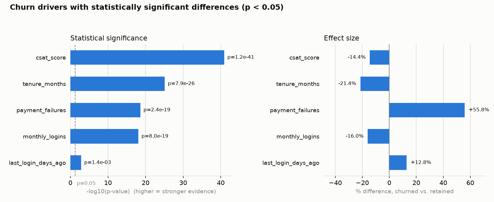

# Customer Churn Analysis

A customer retention and revenue-at-risk analysis of 10,000 customers using Python (pandas, SciPy) from a synthetic subscription-business dataset. The results show five warning signs associated with customers churning and a look at how much potential revenue is lost.

## Approach

Checked data quality: ranges, blanks, duplicates, contradictory records; cleaned data without changing or dropping any original records; tested all 24 factors for significant link to churn (t-tests for numbers, chi-square for categories); drilled into significant factors to find warning-sign thresholds and revenue at risk.

## Key findings

1.  **The first six months are the riskiest.** New customers churned at 28.1%, more than three times the 7.7–8.8% rate of longer-term customers.

2.  **Low satisfaction is a strong warning sign.**  Customers who rated satisfaction (CSAT) 1 or 2 churned at 23.5–26.0%, more than three times the 6.7–7.9% rate of those who rated 3–5.

3.  **Repeated failed payments are a warning sign.**  Customers with two or more failed payments churned at 24.7%, nearly three times the 8.7% rate of customers with zero or one.

4.  **Low usage is a weaker warning sign.** Customers with 13 or fewer monthly logins churned at 14.3%, about 1.6 times the 8–9% rate of more active customers.

5.   **Inactive customers are at risk.**  Customers with no login in over 30 days churned at 19.5%, about twice the 10% rate of others.  At 426 customers, this is the smallest at-risk group, so it ranks below the other warning signs.

6.  **Churn costs about $35,300 a month.** That's 10.1% of monthly revenue, an estimated $424,000 a year.

7.  **Most factors showed no link to churn.** Statistical tests showed 19 of 24 factors had no significant link to churn, including age, gender, location, contract type, support tickets, and all three pricing factors (monthly_fee, discount_applied, and price_increase_last_3m).

## Recommendations

1.  **Strengthen onboarding.**  Customers churn at 28% in their first six months.  Provide a stronger onboarding program with welcome guide, setup help, check-ins after 30 and 90 days to ensure customers' concerns come to light and are addressed.

2.  **Ask why when satisfaction is low.**  The analysis shows CSAT scores of one or two churn at about 3.5 times the rate of customers with higher scores.  When a customer rates 1 or 2, ask a short follow-up question about what went wrong, so the company can identify and fix the causes.

3.  **Prevent failed payments.**  Failed payments may be due to expired credit cards.  Setting up automatic customer reminders prior to card expiration dates could help prevent failed payment problems from arising and hence reduce failed payments.  Automatic alerts to staff after a second failed payment, so they can follow up promptly, may reduce churn.

4.  **Re-engage low-usage customers.**  Low login activity is also associated with churned customers (14.3%) but is the largest group affected (2,739 customers).  Thirteen or fewer logins in a month may trigger emails to be sent to customers showing different features the customer may not know about, or emails with helpful tips or training could encourage customers and engage them to use the services.

5.  **Win back inactive customers.**  Send an automatic ‘we miss you’ email after 30 days without a login.

6.  **Don’t rely on discounts.**  Discounts are unlikely to reduce churn. Monthly fee, discounts and recent price increases all showed no significant link to churn.

## Skills demonstrated

Python (pandas) for cleaning and analysis; data quality checks; statistical testing with SciPy (t-tests and chi-square); grouping and segmentation (groupby, pd.cut, pd.qcut); robustness check; Jupyter notebooks; GitHub.

## How I worked

I used Claude Code, an AI coding assistant, to draft the Python code.  I set the questions and data checks, reviewed the results of each phase before approving changes, and challenged the approach where needed.  For example, I tested login groups a second way (equal-width bands), which confirmed the finding.

Also, I noticed some payment-failure groups were too small to trust (as few as 3 customers), which led to combining them into two groups: 0–1 failures and 2 or more.

## Data and decisions

Synthetic Kaggle dataset of 10,000 customers; blank complaint types kept and flagged rather than guessed; no rows dropped; small groups combined (2+ failed payments); total revenue (roughly tenure_months x monthly_fee) left out as a driver because it reflects tenure.

Some relationships expected in real data are missing (for example, monthly logins and days since last login are uncorrelated), so findings demonstrate method rather than real-world conclusions.

## Files

- `data/`: original and cleaned datasets
- `python/`: `churn_analysis.py` (data checks, cleaning, statistical tests) and `churn_warning_signs.ipynb` (warning-sign thresholds and revenue at risk)
- `outputs/`: HTML report and chart of significant factors

To reproduce: run `python python/churn_analysis.py` from the project folder, then open the notebook.

**Data source:** [Customer Churn Prediction Business Dataset by Arif Miah, Kaggle](https://www.kaggle.com/datasets/miadul/customer-churn-prediction-business-dataset)
